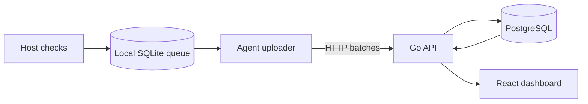
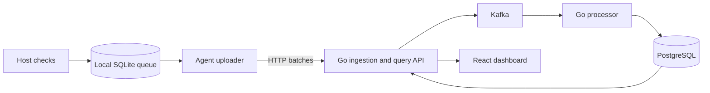

# Personal Network and Computer Health Monitor: Build Plan

Created: 2026-10-27

Status: Proposed implementation and learning plan

Related: [Distributed systems project ideas](distributed-systems-project-ideas.md)

## 1. What you are building

A personal monitor that answers:

- Is connectivity unreliable, and when did failures occur?
- Is a particular service slow, or are several independent checks failing?
- Is my disk running out of space?
- Is the monitored computer reporting fresh data?
- Does monitoring history survive an agent restart or a backend outage?

Start with one computer you own. Run a Go agent directly on that host and the backend in Docker Compose. Add a second real computer only if one is available; simulated agents can supply additional load later.

The agent should run on your actual operating system. Supporting additional operating systems is an extension, not a prerequisite.

**First useful release:** real readings, persistent history, and a way to inspect failures. **Completed learning project:** the same application with Kafka processing, tested recovery, operational metrics, and reproducible benchmarks.

Personal traffic will not require Kafka. Kafka is an intentional learning step, and synthetic scale tests must be reported separately from everyday usage.

## 2. Scope and schedule

Budget roughly 8–10 weeks at 8–10 hours per week, including learning and debugging. Treat this as a planning estimate, not a deadline. Move forward when the completion checks pass.

| Milestone | Approximate period | Working result |
| --- | --- | --- |
| M0: Setup and Go foundations | First 1–2 sessions | Repository, configuration, one timed HTTP check |
| M1: Durable host agent | Weeks 1–2 | Real readings persist locally through restarts |
| M2: Ingestion and history | Weeks 2–3 | Agent uploads to an API; readings can be queried |
| M3: Personal dashboard and incidents | Weeks 3–4 | A useful daily monitor with historical incidents |
| M4: Kafka processing | Weeks 4–6 | Separate ingestion and processing with safe retries |
| M5: Recovery and replay | Weeks 6–7 | Demonstrated correctness through selected failures |
| M6: Observability and daily operation | Weeks 7–8 | Inspect the monitor itself and run it for seven days |
| M7: Scaling and final demo | Weeks 9–10 | Reproducible load experiments and project write-up |

Study the concepts needed for the next milestone, then implement them. Avoid completing a full Go, Kafka, or Kubernetes course before starting.

## 3. Technology stack

| Area | Choice | Introduce at |
| --- | --- | --- |
| Agent, API, processor, simulator | Go | M0 onward |
| HTTP client/server | Standard `net/http`, `net`, and `context` packages | M0 |
| Host disk readings | gopsutil | M1 |
| Local durable queue | SQLite through `database/sql` and modernc.org/sqlite | M1 |
| Backend storage | PostgreSQL with pgx and versioned SQL migrations | M2 |
| Local services | Docker Compose with persistent volumes | M2 |
| User dashboard | React, TypeScript, Vite | M3 |
| Event streaming | Apache Kafka, franz-go | M4 |
| Application logs | Go `log/slog` with structured fields | M1 onward |
| Metrics and traces | Prometheus, Grafana, OpenTelemetry | M6 |
| Load generation | Go simulator; k6 for HTTP load | M7 |
| CI | GitHub Actions | M2 onward |

Pin dependency and container versions when implementation begins. Keep the host agent outside Docker so it measures the intended host rather than the container's filesystem or network view.

Use a separate application repository when building this. This career-ops folder holds the plan; there is no need to turn career-ops into the monitor's codebase.

## 4. Architecture and data contract

### First working architecture

### Architecture after M4

The local queue and Kafka have different jobs: SQLite keeps readings while the agent cannot reach the backend; Kafka buffers accepted events while processors or PostgreSQL are unavailable.

### Initial checks

| Check | Initial behavior | What it tells you |
| --- | --- | --- |
| HTTP reachability | Every 30 seconds, request two independently hosted, configurable targets with a timeout | Whether those targets are reachable from this machine |
| DNS resolution | Every 30 seconds, resolve a configured hostname and record elapsed time | Whether the configured resolver path returned a result |
| Disk free space | Every 60 seconds, measure one configured host volume | Available storage on that volume |
| Heartbeat | Every 30 seconds, record an agent heartbeat | Whether the agent is generating observations |

Use lightweight requests and configurable targets. HTTP time includes several stages; do not label it network latency alone. DNS measurements can include caching and do not establish authoritative DNS performance.

Failed checks are events too. Do not silently omit them or record a failed request as zero latency. Begin with these checks; CPU, memory, Wi-Fi signal, and packet-loss measurements can wait.

### Event fields

| Field | Purpose |
| --- | --- |
| `schema_version` | Identify the event format |
| `event_id` | Stable unique ID, preserved across retries |
| `device_id` | Persisted agent identity |
| `sequence` | Persisted, increasing counter assigned when enqueuing an event |
| `check_id` | Stable configured check identifier |
| `observed_at` | UTC time the check ran |
| `kind` | HTTP, DNS, disk, or heartbeat |
| `status` | Success or failure |
| `duration_ms` | Elapsed duration where relevant |
| `value` and `unit` | Typed measurement, such as free bytes |
| `error_code` | Bounded classification such as timeout or DNS failure |

The backend adds `received_at` and `processed_at`. Keep client observation time and server arrival time separate. Measure elapsed check durations with a monotonic clock; wall-clock timestamps can move.

Persist the event and next sequence value in one SQLite transaction. If the agent database is discarded, generate a new device identity rather than silently reusing an identity with a reset counter.

### Retention and bounds

Proposed starting settings, to be adjusted after measuring:

- Local queue: at most 24 hours of events or 100 MB, whichever comes first.
- Queue overflow: evict oldest queued events in bounded batches; persist and expose a dropped-event count and affected time range.
- PostgreSQL history: 30 days, using an indexed timestamp and scheduled batched deletion initially.
- Kafka history: 7 days after M4, subject to available disk space and a configured size bound.
- HTTP batch: at most 100 events and 256 KiB; validate both limits.

These limits deliberately bound recovery guarantees. Events evicted locally or expired from Kafka cannot be promised recoverable. Run loss-free acceptance experiments within the retention limits and reconcile any deliberate drops separately.

## 5. Milestones and learning

### M0. Setup and Go foundations

**Learn:** Go modules, structs, interfaces, explicit error handling, JSON, tests, contexts, and HTTP timeouts. Focus on the differences from C# rather than relearning programming fundamentals.

**Build:**

- Create a repository with `cmd/agent`, `cmd/server`, `internal/`, `migrations/`, `web/`, and `experiments/`.
- Initialize one Go module. Keep packages small; introduce interfaces where tests or real alternate implementations need them.
- Write a command that requests a configured URL, measures duration, and prints a structured result.
- Add a timeout, clear configuration errors, and graceful termination.

**Completion checks:**

- A reachable endpoint returns a successful reading.
- A deliberately slow local test endpoint produces a timeout reading.
- You can explain how `context` cancellation reaches the HTTP request.

**Study:** [A Tour of Go](https://go.dev/tour/) and the [`net/http` reference](https://pkg.go.dev/net/http).

### M1. Collect real readings and persist them locally

**Learn:** goroutines, bounded concurrency, tickers, cancellation, SQLite transactions, queue acknowledgment, and host filesystem measurements.

**Build:**

- Implement the four initial check types and configurable intervals.
- Run each check with a deadline and prevent overlapping executions of the same check.
- Persist every reading to SQLite before considering it queued.
- Add a local command to inspect recent readings and queue depth.
- Implement the retention limits and visible overflow accounting.
- Serialize SQLite writes initially; do not build a general-purpose queue framework.

**Completion checks:**

- Run the agent overnight and inspect actual connectivity and disk history.
- Restart the process and verify queued events, identity, and sequence survive.
- Slow a check and verify other checks continue.
- Test queue overflow with a deliberately small test limit and inspect the loss counter.

**Study:** [gopsutil](https://github.com/shirou/gopsutil), [modernc SQLite driver](https://pkg.go.dev/modernc.org/sqlite), and [SQLite WAL](https://www.sqlite.org/wal.html). Understand WAL's concurrency and durability trade-offs before deciding whether to enable it; it is not required for the first single-writer implementation.

### M2. Upload readings and query persistent history

**Learn:** HTTP API contracts, SQL constraints and indexes, transactions, connection pools, migrations, bounded retries, and ambiguous request outcomes.

**Build:**

- Add `POST /v1/events`, device listing, and time-bounded history queries.
- Validate an entire batch before writing it. In this milestone, acknowledge only after its PostgreSQL transaction commits.
- Add a unique constraint on `event_id`; repeated submissions must not duplicate history.
- Record latest check state only when the incoming device sequence is newer.
- Upload queued events in bounded batches. Delete local events only after a successful acknowledgment.
- Retry temporary failures with exponential backoff and jitter. Treat invalid events as visible terminal failures rather than retrying them forever.
- Add a per-agent bearer token. Keep services bound to localhost initially; use HTTPS before sending credentials across an untrusted network.
- Add Docker Compose for PostgreSQL and the API, persistent volumes, and CI for `go test`, `go vet`, and build checks.

**Completion checks:**

- Query real host readings through the API.
- Stop the API for 10 minutes, keep collecting, restart it, and reconcile queued IDs with stored IDs.
- Simulate a committed write whose HTTP response is lost; retrying produces one history row per event.
- Verify invalid requests and missing credentials are rejected clearly.

**Study:** [Go database tutorial](https://go.dev/doc/tutorial/database-access), [pgx](https://github.com/jackc/pgx), and [PostgreSQL constraints](https://www.postgresql.org/docs/current/ddl-constraints.html). The Go tutorial teaches database concepts with `database/sql`; the backend implementation can use pgx directly.

### M3. Build the dashboard and incident timeline

**Learn:** time-series presentation, missing-data semantics, threshold duration, alert state transitions, and event time versus arrival time.

**Build:**

- Show current check results, observation age, disk free space, and a 24-hour history.
- Label stale readings explicitly; do not display old successful readings as current health.
- Add a persisted incident timeline with open and resolved states.
- Start with a configurable rule: three consecutive timely failures of the same check open an incident; two timely successes resolve it. Reset the streak after a defined observation gap.
- Add a disk rule such as less than 10% free for five minutes, with a separate recovery threshold to prevent rapid state changes.
- Store incident transitions transactionally with reading processing. Deduplicate transitions using their triggering event and rule identity.
- Keep alerts in the dashboard initially. Notifications can follow once false positives are understood.

**Completion checks:**

- Use a controlled local endpoint to open and resolve an incident.
- Replay a duplicate event and verify it does not create another incident transition.
- Upload old buffered failures and verify they appear in history without being presented as a current outage.
- Distinguish “check failing,” “agent data stale,” and “backend unreachable.”

An absent heartbeat does not prove the monitored computer is offline: the agent, connection, or ingestion service may have failed. If agent and backend run on the same computer, its shutdown also removes the dashboard. An independent monitoring host is needed for live detection of that failure.

For the initial live rules, ignore observations older than a configurable freshness window, such as five minutes, and observations older than the latest processed sequence for that check. Historical incident reconstruction is a separate replay operation.

### M4. Introduce Kafka and a separate processor

**Learn:** topics, keys, partitions, consumer groups, offsets, producer acknowledgments, retention, rebalances, and at-least-once delivery.

**Build:**

- Add one Kafka broker with persistent storage to Compose and a telemetry topic with a small fixed partition count, such as three.
- Publish through franz-go, keyed by `device_id`.
- Change ingestion acknowledgment to mean “every event in the batch was acknowledged by Kafka,” rather than “already queryable in PostgreSQL.” Document this API change.
- If publishing partially succeeds or its outcome is uncertain, retry with the same event IDs. A successful API response requires all records to have acknowledged outcomes.
- Move history, latest-state, and incident updates into a separate processor.
- Process each partition in order initially. Commit consumer progress only after the corresponding database transaction commits; never advance past unprocessed records in that partition.
- Keep PostgreSQL uniqueness checks and conditional latest-state updates.
- Quarantine an unreadable record durably with its partition, offset, and error before advancing past it. Expose this as an error, not a successful reading.

**Completion checks:**

- Stop the processor: ingestion continues and events become queryable after it restarts.
- Stop PostgreSQL: processing progress does not advance beyond failed writes.
- Kill the processor after a database commit but before its offset commit; redelivery leaves history and incident transitions unchanged.
- Run two processors in the same consumer group and inspect partition assignment.
- Explain why Kafka transactions alone do not make the PostgreSQL side effects exactly once.

One broker is a development setup. Producer acknowledgments and persistent volumes do not make it tolerant of permanent loss of that broker's storage.

**Study:** [Kafka introduction](https://kafka.apache.org/intro/), [Kafka quickstart](https://kafka.apache.org/quickstart/), and [franz-go documentation](https://github.com/twmb/franz-go).

### M5. Test recovery, ordering, and historical replay

**Learn:** failure injection, idempotency boundaries, checkpointing, late events, clock skew, and deterministic reconstruction.

**Build:**

- Add controlled experiment scripts for agent restart, API outage, processor crash, PostgreSQL outage, and duplicated batches.
- Add a historical replay command that writes to separate derived tables or a versioned result namespace.
- Preserve original event IDs and timestamps during replay. Never send live notifications or overwrite current live status as a side effect.
- For historical incidents, define ordering by device/check and sequence, and handle sequence gaps explicitly.
- Make experiment data use separate device IDs from your real computer.

**Completion checks:**

| Experiment | Expected evidence |
| --- | --- |
| Duplicate batch | One raw history row and one applicable incident transition per original event |
| API outage within queue limits | Collected event IDs reconcile after reconnect |
| Processor crash after DB commit | Redelivery does not duplicate effects |
| Old failed readings arrive after recovery | History includes failures; current status remains fresh |
| Replay same bounded input twice | Rebuilt derived results match; no live side effects |
| Clock moves or long gap occurs | Freshness and incident logic follow the documented policy |

Keep the input event manifest for these tests. Compare IDs and outcomes, rather than claiming no loss because row counts happen to match.

### M6. Observe and operate the monitor

**Learn:** counters, gauges, histograms, metric label cardinality, trace context, health checks, and freshness objectives.

**Build:**

- Export agent queue depth, oldest queued age, dropped-event totals, upload failures, API latency, Kafka lag, processor errors, and database write latency.
- Add Prometheus and Grafana dashboards for the pipeline.
- Instrument ingestion and processing with OpenTelemetry; carry trace context in Kafka headers. Add a trace backend only when you are ready to inspect traces.
- Keep unique event IDs in logs or traces rather than metric labels.
- Distinguish liveness from readiness. After M4, ingestion needs Kafka; querying needs PostgreSQL.
- Register the agent with your host OS's startup/service mechanism, then run it for seven days.

**Completion checks:**

- During a processor outage, Grafana shows growing backlog while ingestion still accepts events.
- You can distinguish slow uploads from slow processing and slow database writes.
- Record actual resource consumption and any false or misleading incidents during the seven-day run.
- Define an initial freshness objective from measured behavior, excluding intentionally disconnected agents, and state the exclusion clearly.

Use the React dashboard for personal readings and incidents, and Grafana for the monitor's operating health. Prometheus does not replace the application's durable event history.

**Study:** [OpenTelemetry for Go](https://opentelemetry.io/docs/languages/go/) and [Prometheus instrumentation guidance](https://prometheus.io/docs/practices/instrumentation/).

### M7. Measure scale and produce the final demonstration

**Learn:** workload design, bottleneck analysis, saturation, backpressure, tail latency, and reproducible benchmarking.

**Build:**

- Add a Go simulator that creates many independent device IDs without probing external websites.
- Use k6 to exercise ingestion and query endpoints.
- Establish a baseline, then increase input rate in steps while measuring accepted and completed throughput separately.
- Compare one and two processor instances, then a third if useful. More consumers than partitions will not create more partition-processing capacity in the same group.
- Test both evenly distributed traffic and a high-volume device that creates partition skew.
- Change one variable at a time: batch size, worker count, or database write strategy.

**Completion checks:**

- Publish hardware, service placement, dependency versions, partition count, data size, run duration, and warm-up method.
- Report p50/p95/p99 processing and query latency, throughput, lag, CPU/memory, and recovery time.
- Explain the first observed bottleneck and show whether one change helped.
- Reconcile event IDs after at least one load-and-recovery experiment.
- Keep simulated benchmarks separate from the seven-day personal-usage report.

**Study:** [k6 getting started](https://grafana.com/docs/k6/latest/get-started/).

## 6. Definition of done

- [ ] A real host agent collects HTTP, DNS, disk, and heartbeat events.
- [ ] Readings survive restarts and bounded backend outages.
- [ ] The dashboard shows history, freshness, and incident transitions.
- [ ] Kafka ingestion and PostgreSQL processing have documented acknowledgment boundaries.
- [ ] Duplicate delivery does not duplicate stored history or incident transitions.
- [ ] Historical replay does not change live state or trigger live notifications.
- [ ] Failure experiments have saved inputs and reconciled outputs.
- [ ] Seven days of personal usage have been reviewed.
- [ ] A repeatable synthetic load experiment identifies a bottleneck.
- [ ] A README, architecture one-pager, benchmark report, short demo, and postmortem exist.

## 7. Optional extensions after completion

1. **Independent monitoring location:** run the backend or an external probe on a separate machine to distinguish more host and network failures. Add TLS and restricted access before exposing it.
2. **Notifications:** send incident-open and incident-resolved messages to a channel you choose. Use a transactional outbox and stable notification IDs; document duplicate-delivery behavior.
3. **Replicated Kafka:** use a multi-broker setup and test leader failure, replication settings, and unavailable replicas. Containers on one machine still share a host failure domain.
4. **Kubernetes with kind:** learn deployments, probes, resource requests/limits, and rollouts after the Compose system is understood.
5. **Cloud and Terraform:** deploy the useful monitor with explicit storage, cost, and teardown choices.
6. **More telemetry:** add CPU/memory, service checks, or home sensors based on actual needs.

Keep these out of the initial completion criteria. The project is already useful before cloud hosting or Kubernetes.

## 8. First working session

1. Create the separate application repository and initialize a Go module.
2. Read the Go tour sections on structs, errors, interfaces, and concurrency.
3. Implement one timed HTTP check with a context deadline.
4. Write success and timeout tests using a local HTTP test server.
5. Print structured results and write down the proposed event fields.
6. Commit that small working slice before adding SQLite or infrastructure.
